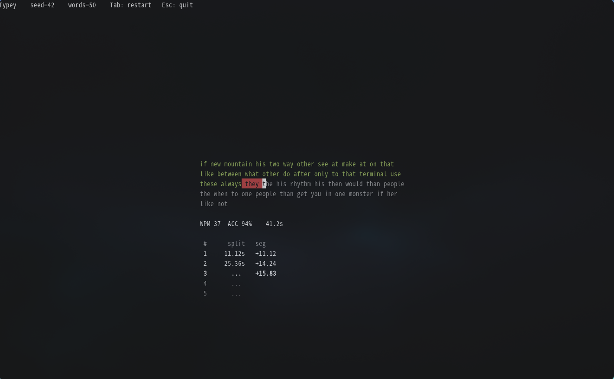
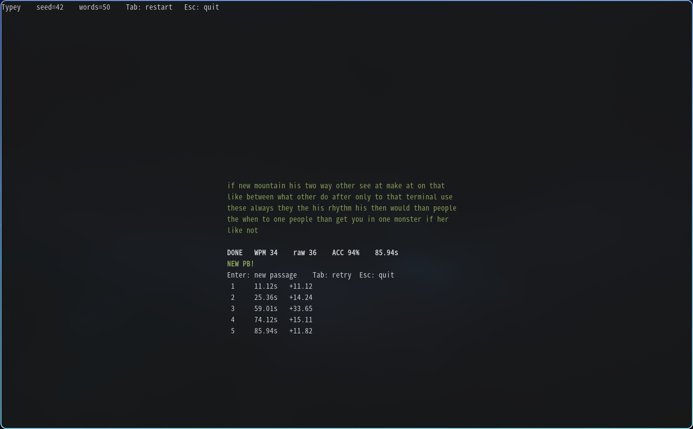

# Typey

Typey is a typing speed test for terminal, built like a speedrun timer, written in C++ with ncurses.

Done for terra <3
Theme: Split (The sections in game speedrunning are called speedrunning splits so thats why)





## Features

- Live WPm and accuracy timer
- Speedrun **splits**: a time for every segment of the passage
- **Personal Bests** saved per passage, with live deltas on every split.
- Correct/wrong coloring with Backspace corrections
- Redo passages: the same seed and word list.

## Build and Run
```shell
git clone https://github.com/Tretaq/Typey.git
cd Typey
cmake -S . -B build -DCMAKE_BUILD_TYPE=Release
cmake --build build
cd build
./Typey
```

Please run it from `build` folder since thats where `words.txt` is copied. 

## Options

| Option | Meaning | Default |
|---|---|---|
| `--words N` | Number of words in the passage (1-100) | 25 |
| `--seed S` | Seed for the passage (same seed == same passage) | random |
| `--split N` | Words per split segment | 8 |
| `--file PATH` | Word list to draw from| `words.txt`|
|`--pb-file`| Where personal bests are stored | 'pb.txt' in project dir |

Example: `./Typey --words 50 --split 10 --seed 42`

## Controls 

| Key | Action |
|---|---|
| Letters, digits, symbols | Type |
|Backspace | The backspace operation in this is a multi-layerd computational event that translates a physical keystroke into the destructive mutation of an in-memory character buffer and a synchronus recalculation of the graphical viewport. (Fix what mess you done while typing)|
| Tab | Restart the same passage |
| Enter (After finishing) | New passage |
| Esc | Quit |

## File template 
Just word after word like 
```
are you ready to play some Deadlock
```
## TO DO

- More fun so like flashes and all 
- find an api with free sentences and not just RANDOM WORDS 
- Ghost trailing ig? like in trackmania

## if your down here and want to experience the true horrors of this, run:
```shell
./Typey --words 100 --split 10  --file ./ExtremeList.txt         
```
i hope you have fun <3 